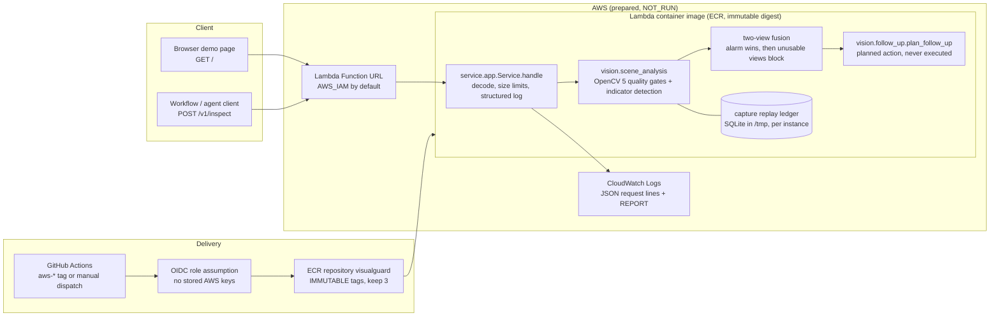
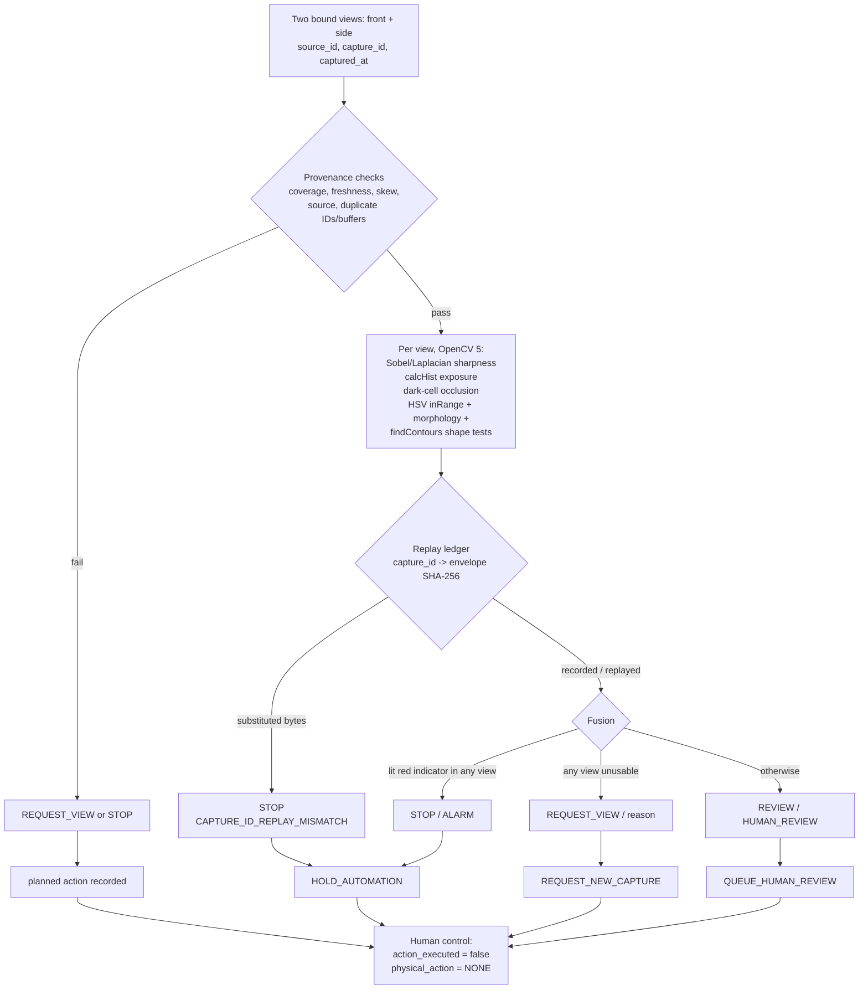

# VisualGuard architecture

Status labels are part of the diagram: anything marked **NOT_RUN** has not
executed on AWS. Local, CI and emulator runs are listed in
[`TECHNICAL_REPORT.md`](TECHNICAL_REPORT.md).

## System

The same `Service.handle` core runs in three places with identical rules:
`python -m service.app` (local), the `http` image target (App Runner / ECS /
local container), and the `lambda` image target through
`service.lambda_handler.handler`.

## Perception, decision, action loop

The vision result changes the next step: the same request shape yields
`QUEUE_HUMAN_REVIEW`, `REQUEST_NEW_CAPTURE` or `HOLD_AUTOMATION` depending on
the pixels. Every `/v1/inspect` response includes a `trace` with the
`perceive`, `decide` and `plan` steps, and every request writes one JSON log
line (no image data).

## Trust boundaries and limits

- Replay protection is per Lambda execution environment (SQLite in `/tmp`).
  Concurrent instances do not share it; a shared store (for example
  DynamoDB conditional writes) would be needed for global replay protection.
- `execution_environment` in responses is self-reported. The Lambda Runtime
  Interface Emulator sets the same variables locally, so only AWS-side
  evidence (CloudWatch `REPORT` lines, `aws lambda invoke` results) counts.
- The witness/anchor modules in `vision/opencv5_inspection.py` use local
  HMAC fixtures; no independently administered witness exists.
- No camera, actuator or external side effect exists anywhere in the system.
